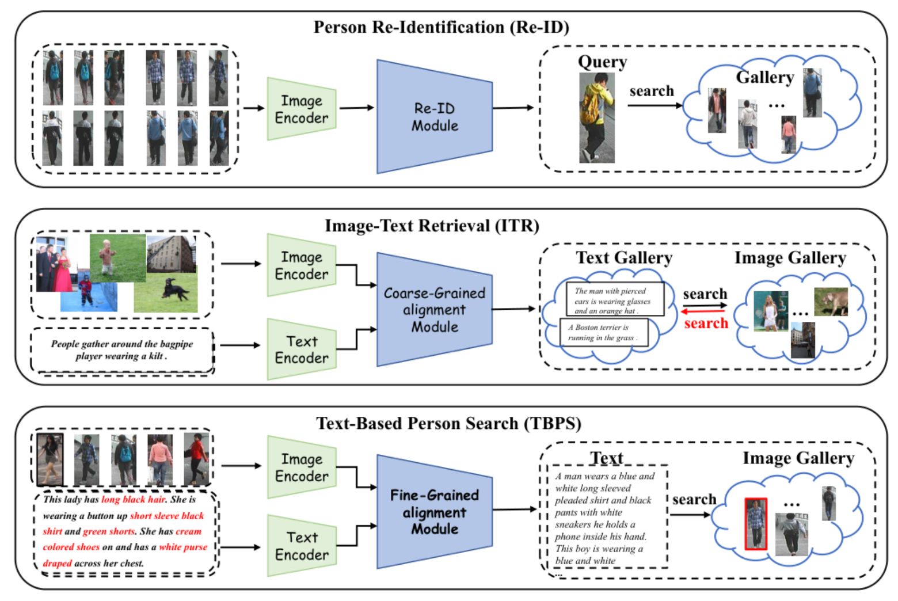
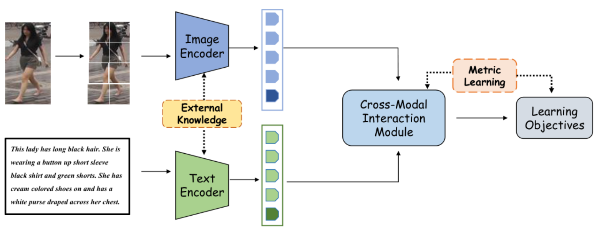

<a id="awesome-text-based-person-search"></a>

<h1 align="center">Awesome Text-Based Person Search <a href="https://awesome.re"></a></h1>

<h3 align="center">
🔥 <a href="https://doi.org/10.1109/TPAMI.2026.3734830">A Survey on Text-Based Person Search</a>
</h3>

<div align="center">
  <p>
    <a href="mailto:shihaitao1111@gmail.com">Haitao Shi</a><sup>1</sup>, <a href="mailto:mengliu.sdu@gmail.com">Meng Liu</a><sup>1</sup>, <a href="mailto:liyongqi0@gmail.com">Yongqi Li</a><sup>2</sup>, <a href="mailto:hanxianjing2018@gmail.com">Xianjing Han</a><sup>3</sup>, <a href="mailto:hyyuan@st.cupk.edu.cn">Yangyuan He</a><sup>4</sup>, <a href="mailto:nieliqiang@gmail.com">Liqiang Nie</a><sup>5</sup>
  </p>
  <p>
    <sup>1</sup>Shandong University, <sup>2</sup>The Hong Kong Polytechnic University,<br>
    <sup>3</sup>School of Electrical and Electronic Engineering, Nanyang Technological University, <sup>4</sup>China University of Petroleum-Beijing at Karamay,<br>
    <sup>5</sup>Harbin Institute of Technology (Shenzhen)
  </p>
  <p>
    <a href="resources/TBPS-Task.png"></a><br>
    <em>Fig. 1. Fundamental distinctions among Re-ID, ITR, and TBPS.</em>
  </p>
</div>

Text-Based Person Search (TBPS) aims to retrieve images of a target pedestrian from a large-scale gallery using **free-form natural-language descriptions**. Unlike image-based person re-identification (Re-ID) and general image-text retrieval (ITR), TBPS requires **fine-grained, identity-sensitive alignment** between textual cues and pedestrian appearance, including clothing, accessories, and local body regions.

<div align="center">
  <p>
    <a href="resources/TBPS-Pipeline.png"></a><br>
    <em>Fig. 2. General training pipeline for TBPS.</em>
  </p>
</div>

A typical TBPS framework combines **visual and textual encoders**, **cross-modal interaction**, and **learning objectives** to learn identity-discriminative representations. External knowledge can provide additional semantic guidance. Our survey organizes representative methods along four complementary perspectives: external knowledge, learning objectives, encoder architectures, and modality interaction.


## News

- [2026.09.17] The survey has been accepted for publication in [IEEE TPAMI](https://doi.org/10.1109/TPAMI.2026.3734830).

## Table of Contents

- [Taxonomy of TBPS Approaches](#taxonomy-of-tbps-approaches)
  - [1. External Knowledge](#1-external-knowledge)
  - [2. Learning Objectives](#2-learning-objectives)
  - [3. Encoder](#3-encoder)
  - [4. Modality Interaction](#4-modality-interaction)
- [Datasets](#datasets)
  - [1. Standard TBPS Benchmarks](#1-standard-tbps-benchmarks)
  - [2. Multimodal Retrieval Datasets](#2-multimodal-retrieval-datasets)
  - [3. Large-Scale Pre-training Datasets](#3-large-scale-pre-training-datasets)
  - [4. Cross-Lingual Datasets](#4-cross-lingual-datasets)

## Taxonomy of TBPS Approaches

The four perspectives overlap; cross-category entries count once in the distinct-title total. Papers are grouped by year in descending order within each module.

### *1. External Knowledge*

> #### *1.1. Pose Knowledge*

#### 2023

- `[2023 ICONIP]` **Multi-level Network Based on Text Attention and Pose-guided for Person Re-ID (PAMN)** *Xi Wang, Canlong Zhang, Zhixin Li, Zhiwen Wang*  
  [[paper]](https://doi.org/10.1007/978-981-99-1648-1_9)

#### 2020

- `[2020 AAAI]` **Pose-guided Multi-granularity Attention Network for Text-based Person Search (PMA)** *Ya Jing, Chenyang Si, Junbo Wang, Wei Wang, Liang Wang, Tieniu Tan*  
  [[paper]](https://arxiv.org/abs/1809.08440v3)

#### 2018

- `[2018 arXiv]` **Cascade Attention Network for Person Search: Both Image and Text-Image Similarity Selection (CAN)** *Ya Jing, Chenyang Si, Junbo Wang, Wei Wang, Liang Wang, Tieniu Tan*  
  [[paper]](https://arxiv.org/abs/1809.08440v1)

> #### *1.2. Attribute Knowledge*

#### 2022

- `[2022 MM]` **Cross-modal Co-occurrence Attributes Alignments for Person Search by Language (C2A2)** *Kai Niu, Linjiang Huang, Yan Huang, Peng Wang, Liang Wang, Yanning Zhang*  
  [[paper]](https://doi.org/10.1145/3503161.3547753)

- `[2022 ICPR]` **Efficient Text-based Person Search via Single-stage Identity-guided Attribute Parsing and Alignment (IAPA)** *Tian-Yu Liu, Chao Zhu, Liu Yang*  
  [[paper]](https://doi.org/10.1109/icpr56361.2022.9956569)

- `[2022 AIIPCC]` **Heterogenous Center Alignment of Dual-path Features for Text-image Person Re-identification (DP-HCA)** *Xianju Wang, Ronald S. Cordova*  
  [[paper]](https://doi.org/10.1109/aiipcc57291.2022.00039)

- `[2022 Neural Computing and Applications]` **Improving Embedding Learning by Virtual Attribute Decoupling for Text-based Person Search (iVAD)** *Chengji Wang, Zhiming Luo, Yaojin Lin, Shaozi Li*  
  [[paper]](https://doi.org/10.1007/s00521-021-06734-9)

#### 2020

- `[2020 TMM]` **Adversarial Attribute-Text Embedding for Person Search with Natural Language Query (AATE)** *Zheng-Jun Zha, Jiawei Liu, Di Chen, Feng Wu*  
  [[paper]](https://doi.org/10.1109/tmm.2020.2972168)

- `[2020 WACV]` **Text-based Person Search via Attribute-aided Matching (CMAAM)** *Surbhi Aggarwal, R. Venkatesh Babu, Anirban Chakraborty*  
  [[paper]](https://openaccess.thecvf.com/content_WACV_2020/html/Aggarwal_Text-based_Person_Search_via_Attribute-aided_Matching_WACV_2020_paper.html)

- `[2020 ECCV]` **ViTAA: Visual-Textual Attributes Alignment in Person Search by Natural Language (ViTAA)** *Zhe Wang, Zhiyuan Fang, Jun Wang, Yezhou Yang*  
  [[paper]](https://www.ecva.net/papers/eccv_2020/papers_ECCV/html/1593_ECCV_2020_paper.php) [[code]](https://github.com/Jarr0d/ViTAA)

> #### *1.3. Color Knowledge*

#### 2022

- `[2022 MM]` **CAIBC: Capturing All-round Information Beyond Color for Text-based Person Retrieval (CAIBC)** *Zijie Wang, Aichun Zhu, Jingyi Xue, Xili Wan, Chao Liu, Tian Wang, Yifeng Li*  
  [[paper]](https://arxiv.org/abs/2209.05773v1)

#### 2021

- `[2021 ICCV]` **LapsCore: Language-guided Person Search via Color Reasoning (LapsCore)** *Yushuang Wu, Zizheng Yan, Xiaoguang Han, Guanbin Li, Changqing Zou, Shuguang Cui*  
  [[paper]](https://openaccess.thecvf.com/content/ICCV2021/html/Wu_LapsCore_Language-Guided_Person_Search_via_Color_Reasoning_ICCV_2021_paper.html)

> #### *1.4. Body Parts Knowledge*

#### 2023

- `[2023 ICCV Workshops]` **BiLMa: Bidirectional Local-matching for Text-based Person Re-identification (BiLMa)** *Takuro Fujii, Shuhei Tarashima*  
  [[paper]](https://arxiv.org/abs/2309.04675v1)

#### 2021

- `[2021 Displays]` **Description-based Person Search with Multi-grained Matching Networks (Tri-MGF)** *Ji Zhu, Hua Yang, Jia Wang, Wenjun Zhang*  
  [[paper]](https://doi.org/10.1016/j.displa.2021.102039)

### *2. Learning Objectives*

> #### *2.1. Identity (ID) Loss*

#### 2022

- `[2022 MM]` **Learning Granularity-unified Representations for Text-to-image Person Re-identification (LGUR)** *Zhiyin Shao, Xinyu Zhang, Meng Fang, Zhifeng Lin, Jian Wang, Changxing Ding*  
  [[paper]](https://arxiv.org/abs/2207.07802v1) [[code]](https://github.com/ZhiyinShao-H/LGUR)

- `[2022 MM]` **Look Before You Leap: Improving Text-based Person Retrieval by Learning a Consistent Cross-modal Common Manifold (LBUL)** *Zijie Wang, Aichun Zhu, Jingyi Xue, Xili Wan, Chao Liu, Tian Wang, Yifeng Li*  
  [[paper]](https://arxiv.org/abs/2209.06209v1)

- `[2022 WWW]` **Relation-aware Aggregation Network with Auxiliary Guidance for Text-based Person Search (RANAG)** *Pengpeng Zeng, Shuaiqi Jing, Jingkuan Song, Kaixuan Fan, Xiangpeng Li, Liansuo We, Yuan Guo*  
  [[paper]](https://doi.org/10.1007/s11280-021-00953-9)

#### 2019

- `[2019 ICCV Workshops]` **Fusing Two Directions in Cross-domain Adaption for Real Life Person Search by Language (FTD)** *Kai Niu, Yan Huang, Liang Wang*  
  [[paper]](https://doi.org/10.1109/iccvw.2019.00225)

> #### *2.2. Matching Loss*

#### 2024

- `[2024 TMM]` **Cross-modal Adaptive Dual Association for Text-to-image Person Retrieval (CADA)** *Dixuan Lin, Yi-Xing Peng, Jingke Meng, Wei-Shi Zheng*  
  [[paper]](https://arxiv.org/abs/2312.01745v1) [[code]](https://github.com/LinDixuan/CADA)

#### 2018

- `[2018 ECCV]` **Deep Cross-modal Projection Learning for Image-Text Matching (CMPM+CMPC)** *Ying Zhang, Huchuan Lu*  
  [[paper]](https://openaccess.thecvf.com/content_ECCV_2018/html/Ying_Zhang_Deep_Cross-Modal_Projection_ECCV_2018_paper.html) [[code]](https://github.com/YingZhangDUT/Cross-Modal-Projection-Learning)

> #### *2.3. Ranking Loss*

#### 2023

- `[2023 ICIP]` **Mining False Positive Examples for Text-based Person Re-identification (MFPE)** *Wenhao Xu, Zhiyin Shao, Changxing Ding*  
  [[paper]](https://arxiv.org/abs/2303.08466v1) [[code]](https://github.com/wh-xu1/MFPE)

#### 2019

- `[2019 arXiv]` **Visual-Textual Association with Hardest and Semi-hard Negative Pairs Mining for Person Search (HSNM)** *Jing Ge, Guangyu Gao, Zhen Liu*  
  [[paper]](https://arxiv.org/abs/1912.03083v1)

> #### *2.4. Adversarial Loss*

#### 2022

- `[2022 EAAI]` **ASPD-Net: Self-aligned Part Mask for Improving Text-based Person Re-identification with Adversarial Representation Learning (ASPD-Net)** *Zijie Wang, Jingyi Xue, Xili Wan, Aichun Zhu, Yifeng Li, Xiaomei Zhu, Fangqiang Hu*  
  [[paper]](https://doi.org/10.1016/j.engappai.2022.105419)

#### 2021

- `[2021 PRCV]` **AMEN: Adversarial Multi-space Embedding Network for Text-based Person Re-identification (AMEN)** *Zijie Wang, Jingyi Xue, Aichun Zhu, Yifeng Li, Mingyi Zhang, Chongliang Zhong*  
  [[paper]](https://doi.org/10.1007/978-3-030-88007-1_38)

#### 2019

- `[2019 MM]` **Deep Adversarial Graph Attention Convolution Network for Text-based Person Search (A-GANet)** *Jiawei Liu, Zheng-Jun Zha, Richang Hong, Meng Wang, Yongdong Zhang*  
  [[paper]](https://doi.org/10.1145/3343031.3350991)

> #### *2.5. MLM/MIM Loss*

#### 2024

- `[2024 AAAI]` **Unifying Multi-Modal Uncertainty Modeling and Semantic Alignment for Text-to-Image Person Re-identification (MLM)** *Zhiwei Zhao, Bin Liu, Yan Lu, Qi Chu, Nenghai Yu*  
  [[paper]](https://doi.org/10.1609/aaai.v38i7.28585)

#### 2023

- `[2023 MM]` **Towards Unified Text-based Person Retrieval: A Large-scale Multi-Attribute and Language Search Benchmark (APTM)** *Shuyu Yang, Yinan Zhou, Zhedong Zheng, Yaxiong Wang, Li Zhu, Yujiao Wu*  
  [[paper]](https://arxiv.org/abs/2306.02898v4) [[code]](https://github.com/Shuyu-XJTU/APTM)

> #### *2.6. Other Loss*

#### 2024

- `[2024 TMM]` **Multi-granularity Matching Transformer for Text-based Person Search (TransTPS)** *Liping Bao, Longhui Wei, Wengang Zhou, Lin Liu, Lingxi Xie, Houqiang Li, Qi Tian*  
  [[paper]](https://doi.org/10.1109/tmm.2023.3321504)

#### 2023

- `[2023 MM]` **DCEL: Deep Cross-modal Evidential Learning for Text-based Person Retrieval (DCEL)** *Shenshen Li, Xing Xu, Yang Yang, Fumin Shen, Yijun Mo, Yujie Li, Heng Tao Shen*  
  [[paper]](https://doi.org/10.1145/3581783.3612244)

#### 2020

- `[2020 MMAsia]` **Multiplicative Angular Margin Loss for Text-based Person Search (PSW+MAM)** *Peng Zhang, Deqiang Ouyang, Feiyu Chen, Jie Shao*  
  [[paper]](https://doi.org/10.1145/3444685.3446314)

### *3. Encoder*

> #### *3.1. CNN-RNN/CNN-BERT Encoders*

#### 2022

- `[2022 TIP]` **Conditional Feature Learning Based Transformer for Text-based Person Search (CFLT)** *Chenyang Gao, Guanyu Cai, Xinyang Jiang, Feng Zheng, Jun Zhang, Yifei Gong, Fangzhou Lin, Xing Sun, Xiang Bai*  
  [[paper]](https://doi.org/10.1109/tip.2022.3205216)

- `[2022 Neurocomputing]` **TIPCB: A Simple but Effective Part-based Convolutional Baseline for Text-based Person Search (TIPCB)** *Yuhao Chen, Guoqing Zhang, Yujiang Lu, Zhenxing Wang, Yuhui Zheng*  
  [[paper]](https://arxiv.org/abs/2105.11628v1) [[code]](https://github.com/OrangeYHChen/TIPCB)

#### 2020

- `[2020 arXiv]` **A Convolutional Baseline for Person Re-identification Using Vision and Language Descriptions (VLCCA)** *Ammarah Farooq, Muhammad Awais, Fei Yan, Josef Kittler, Ali Akbari, Syed Safwan Khalid*  
  [[paper]](https://arxiv.org/abs/2003.00808v1)

- `[2020 TOMM]` **Dual-path Convolutional Image-Text Embeddings with Instance Loss (Dual-path CNN)** *Zhedong Zheng, Liang Zheng, Michael Garrett, Yi Yang, Mingliang Xu, Yi-Dong Shen*  
  [[paper]](https://arxiv.org/abs/1711.05535v4) [[code]](https://github.com/layumi/Image-Text-Embedding)

#### 2019

- `[2019 ICCV]` **Adversarial Representation Learning for Text-to-image Matching (TIMAM)** *Nikolaos Sarafianos, Xiang Xu, Ioannis Kakadiaris*  
  [[paper]](https://arxiv.org/abs/1908.10534v1)

#### 2018

- `[2018 WACV]` **Improving Text-based Person Search by Spatial Matching and Adaptive Threshold (PWM+ATH)** *Tianlang Chen, Chenliang Xu, Jiebo Luo*  
  [[paper]](https://doi.org/10.1109/wacv.2018.00208)

#### 2017

- `[2017 CVPR]` **Person Search with Natural Language Description (GNA-RNN)** *Shuang Li, Tong Xiao, Hongsheng Li, Bolei Zhou, Dayu Yue, Xiaogang Wang*  
  [[paper]](https://openaccess.thecvf.com/content_cvpr_2017/html/Li_Person_Search_With_CVPR_2017_paper.html) [[code]](https://github.com/ShuangLI59/Person-Search-with-Natural-Language-Description)

> #### *3.2. Transformer-Based Encoders*

#### 2024

- `[2024 TCSVT]` **Contrastive Transformer Learning with Proximity Data Generation for Text-based Person Search (PDG)** *Hefeng Wu, Weifeng Chen, Zhibin Liu, Tianshui Chen, Zhiguang Chen, Liang Lin*  
  [[paper]](https://arxiv.org/abs/2311.09084v1) [[code]](https://github.com/HCPLab-SYSU/PersonSearch-CTLG)

#### 2023

- `[2023 TIP]` **CLIP-driven Fine-grained Text-Image Person Re-identification (CFine)** *Shuanglin Yan, Neng Dong, Liyan Zhang, Jinhui Tang*  
  [[paper]](https://arxiv.org/abs/2210.10276v1) [[code]](https://github.com/ShuanglinYan/CFine)

- `[2023 ICONIP]` **Text-based Person Re-ID by Saliency Mask and Dynamic Label Smoothing (SMDLS)** *Yonghua Pang, Canlong Zhang, Zhixin Li, Liaojie Hu*  
  [[paper]](https://doi.org/10.1007/978-981-99-8073-4_34)

#### 2022

- `[2022 ICASSP]` **Learning Semantic-aligned Feature Representation for Text-based Person Search (SAPF)** *Shiping Li, Min Cao, Min Zhang*  
  [[paper]](https://arxiv.org/abs/2112.06714v1) [[code]](https://github.com/reallsp/SAF)

> #### *3.3. VLM-Based Encoders*

#### 2024

- `[2024 AAAI]` **An Empirical Study of CLIP for Text-based Person Search (TBPS-CLIP)** *Min Cao, Yang Bai, Ziyin Zeng, Mang Ye, Min Zhang*  
  [[paper]](https://arxiv.org/abs/2308.10045v2) [[code]](https://github.com/Flame-Chasers/TBPS-CLIP)

#### 2023

- `[2023 arXiv]` **Exploiting the Textual Potential from Vision-Language Pre-training for Text-based Person Search (TP-TPS)** *Guanshuo Wang, Fufu Yu, Junjie Li, Qiong Jia, Shouhong Ding*  
  [[paper]](https://arxiv.org/abs/2303.04497)

### *4. Modality Interaction*

> #### *4.1. Intra-Modality Interaction*


> ##### *4.1.1. Visual Intra-modal Interaction*

#### 2024

- `[2024 AAAI]` **Adaptive Uncertainty-based Learning for Text-based Person Retrieval (AUL)** *Shenshen Li, Chen He, Xing Xu, Fumin Shen, Yang Yang, Heng Tao Shen*  
  [[paper]](https://doi.org/10.1609/aaai.v38i4.28101) [[code]](https://github.com/CFM-MSG/Code-AUL)

- `[2024 Image and Vision Computing]` **EESSO: Exploiting Extreme and Smooth Signals via Omni-frequency Learning for Text-based Person Retrieval (EESSO)** *Jingyi Xue, Zijie Wang, Guan-Nan Dong, Aichun Zhu*  
  [[paper]](https://doi.org/10.1016/j.imavis.2024.104912)

> ##### *4.1.2. Textual Intra-modal Interaction*

#### 2025

- `[2025 TMM]` **Multi-modal Reference Learning for Fine-grained Text-to-image Retrieval (MMRef)** *Zehong Ma, Hao Chen, Wei Zeng, Limin Su, Shiliang Zhang*  
  [[paper]](https://arxiv.org/abs/2504.07718v1)

#### 2023

- `[2023 TMM]` **Refined Knowledge Transfer for Language-based Person Search (RKT)** *Ziqiang Wu, Bingpeng Ma, Hong Chang, Shiguang Shan*  
  [[paper]](https://doi.org/10.1109/tmm.2023.3251104)

#### 2020

- `[2020 MM]` **Textual Dependency Embedding for Person Search by Language (TDE)** *Kai Niu, Yan Huang, Liang Wang*  
  [[paper]](https://doi.org/10.1145/3394171.3413895)

> ##### *4.1.3. Dual Intra-modal Interaction*

#### 2023

- `[2023 MM]` **Learning Comprehensive Representations with Richer Self for Text-to-image Person Re-identification (LCR²S)** *Shuanglin Yan, Neng Dong, Jun Liu, Liyan Zhang, Jinhui Tang*  
  [[paper]](https://arxiv.org/abs/2310.11210v1)

#### 2022

- `[2022 Neurocomputing]` **TIPCB: A Simple but Effective Part-based Convolutional Baseline for Text-based Person Search (TIPCB)** *Yuhao Chen, Guoqing Zhang, Yujiang Lu, Zhenxing Wang, Yuhui Zheng*  
  [[paper]](https://arxiv.org/abs/2105.11628v1) [[code]](https://github.com/OrangeYHChen/TIPCB)

#### 2021

- `[2021 Neurocomputing]` **Divide-and-merge the Embedding Space for Cross-modality Person Search (DME)** *Chengji Wang, Zhiming Luo, Zhun Zhong, Shaozi Li*  
  [[paper]](https://doi.org/10.1016/j.neucom.2021.08.058)

> #### *4.2. Inter-Modality Interaction*

Methods spanning multiple interaction types appear once, under a representative subgroup.


> ##### *4.2.1. Global Feature Interaction*

#### 2022

- `[2022 AIEA]` **Person Re-identification from Text to Image Based on Mutual Teaching (MTReID)** *Chengjian MO*  
  [[paper]](https://doi.org/10.1117/12.2646862)

> ##### *4.2.2. Local Feature Interaction*

#### 2023

- `[2023 KBS]` **Text-based Person Search via Local-Relational-Global Fine-grained Alignment (CM-LRGNet)** *Junfeng Zhou, Baigang Huang, Wenjiao Fan, Ziqian Cheng, Zhuoyi Zhao, Weifeng Zhang*  
  [[paper]](https://doi.org/10.1016/j.knosys.2023.110253) [[code]](https://github.com/zhangweifeng1218/Text-based-Person-Search)

- `[2023 MM]` **Pedestrian-specific Bipartite-aware Similarity Learning for Text-based Person Retrieval (PBSL)** *Fei Shen, Xiangbo Shu, Xiaoyu Du, Jinhui Tang*  
  [[paper]](https://doi.org/10.1145/3581783.3612009)

- `[2023 ICME]` **Multi-level Part-aware Feature Disentangling for Text-based Person Search (MPFD)** *Yuhao Chen, Guoqing Zhang, Hongwei Zhang, Yuhui Zheng, Weisi Lin*  
  [[paper]](https://doi.org/10.1109/icme55011.2023.00476)

#### 2022

- `[2022 TCSVT]` **Transformer-based Language-Person Search with Multiple Region Slicing (T-MRS)** *Hui Li, Jimin Xiao, Mingjie Sun, Eng Gee Lim, Yao Zhao*  
  [[paper]](https://doi.org/10.1109/tcsvt.2021.3073718)

#### 2021

- `[2021 TIP]` **Cross-modal Knowledge Adaptation for Language-based Person Search (CMKA)** *Yucheng Chen, Rui Huang, Hong Chang, Chuanqi Tan, Tao Xue, Bingpeng Ma*  
  [[paper]](https://doi.org/10.1109/tip.2021.3068825)

- `[2021 arXiv]` **Contextual Non-local Alignment over Full-scale Representation for Text-based Person Search (NAFS with RVN)** *Chenyang Gao, Guanyu Cai, Xinyang Jiang, Feng Zheng, Jun Zhang, Yifei Gong, Pai Peng, Xiaowei Guo, Xing Sun*  
  [[paper]](https://arxiv.org/abs/2101.03036v1) [[code]](https://github.com/TencentYoutuResearch/PersonReID-NAFS)

> ##### *4.2.3. Multi-Granularity Feature Interaction*

#### 2025

- `[2025 TIFS]` **Granularity-aware Hyperbolic Representation for Text-based Person Search (GAHR)** *Chenghuan Qi, Xi Yang, Nannan Wang, Xinbo Gao*  
  [[paper]](https://doi.org/10.1109/tifs.2025.3574970)

#### 2024

- `[2024 TNNLS]` **Image-specific Information Suppression and Implicit Local Alignment for Text-based Person Search (MANet)** *Shuanglin Yan, Hao Tang, Liyan Zhang, Jinhui Tang*  
  [[paper]](https://arxiv.org/abs/2208.14365v2) [[code]](https://github.com/shuanglinyan/MANet)

#### 2023

- `[2023 Electronics Letters]` **Multi-level Cross-modality Learning Framework for Text-based Person Re-identification (MCL)** *Tinghui Wu, Shuhe Zhang, Dihu Chen, Haifeng Hu*  
  [[paper]](https://doi.org/10.1049/ell2.12975)

- `[2023 Frontiers in Physics]` **Feature Semantic Alignment and Information Supplement for Text-based Person Search (ESFE+ISN)** *Hang Zhou, Fan Li, Xuening Tian, Yuling Huang*  
  [[paper]](https://doi.org/10.3389/fphy.2023.1192412)

- `[2023 TMM]` **Asymmetric Cross-scale Alignment for Text-based Person Search (ACSA)** *Zhong Ji, Junhua Hu, Deyin Liu, Lin Yuanbo Wu, Ye Zhao*  
  [[paper]](https://arxiv.org/abs/2212.11958v1) [[code]](https://github.com/mul-hjh/ACSA)

#### 2021

- `[2021 IJCAI]` **Text-based Person Search via Multi-granularity Embedding Learning (MGEL)** *Chengji Wang, Zhiming Luo, Yaojin Lin, Shaozi Li*  
  [[paper]](https://doi.org/10.24963/ijcai.2021/148)

#### 2020

- `[2020 TIP]` **Improving Description-based Person Re-identification by Multi-granularity Image-Text Alignments (MIA)** *Kai Niu, Yan Huang, Wanli Ouyang, Liang Wang*  
  [[paper]](https://arxiv.org/abs/1906.09610v1)

- `[2020 MM]` **Hierarchical Gumbel Attention Network for Text-based Person Search (HGAN)** *Kecheng Zheng, Wu Liu, Jiawei Liu, Zheng-Jun Zha, Tao Mei*  
  [[paper]](https://doi.org/10.1145/3394171.3413864)

#### 2018

- `[2018 ECCV]` **Improving Deep Visual Representation for Person Re-identification by Global and Local Image-Language Association (GL-ILA)** *Dapeng Chen, Hongsheng Li, Xihui Liu, Yantao Shen, Jing Shao, Zejian Yuan, Xiaogang Wang*  
  [[paper]](https://openaccess.thecvf.com/content_ECCV_2018/html/Dapeng_Chen_Improving_Deep_Visual_ECCV_2018_paper.html)

> ##### *4.2.4. Proxy Task-Guided Interaction*

#### 2025

- `[2025 TOMM]` **MARS: Paying More Attention to Visual Attributes for Text-based Person Search (MARS)** *Alex Ergasti, Tomaso Fontanini, Claudio Ferrari, Massimo Bertozzi, Andrea Prati*  
  [[paper]](https://arxiv.org/abs/2407.04287v1) [[code]](https://github.com/ErgastiAlex/MARS)

#### 2024

- `[2024 ICME]` **LAIP: Learning Local Alignment from Image-Phrase Modeling for Text-based Person Search (LAIP)** *Yu Wu, Haiguang Wang, Mengxia Wu, Min Cao, Min Zhang*  
  [[paper]](https://arxiv.org/abs/2406.10845v2)

#### 2023

- `[2023 arXiv]` **Calibrating Cross-modal Feature for Text-based Person Searching (CMCalib)** *Donglai Wei, Sipeng Zhang, Tong Yang, Jing Liu*  
  [[paper]](https://arxiv.org/abs/2304.02278v1)

- `[2023 arXiv]` **Unleashing the Imagination of Text: A Novel Framework for Text-to-image Person Retrieval via Exploring the Power of Words (UIT)**

- `[2023 arXiv]` **Learning Transferable Pedestrian Representation from Multimodal Information Supervision (VAL-PAT)** *Liping Bao, Longhui Wei, Xiaoyu Qiu, Wengang Zhou, Houqiang Li, Qi Tian*  
  [[paper]](https://arxiv.org/abs/2304.05554v1)

- `[2023 CVPR]` **Cross-modal Implicit Relation Reasoning and Aligning for Text-to-image Person Retrieval (IRRA)** *Ding Jiang, Mang Ye*  
  [[paper]](https://openaccess.thecvf.com/content/CVPR2023/html/Jiang_Cross-Modal_Implicit_Relation_Reasoning_and_Aligning_for_Text-to-Image_Person_Retrieval_CVPR_2023_paper.html) [[code]](https://github.com/anosorae/IRRA)

#### 2022

- `[2022 IEEE SPL]` **Joint Token and Feature Alignment Framework for Text-based Person Search (TFAF)** *Shangze Li, Andong Lu, Yan Huang, Chenglong Li, Liang Wang*  
  [[paper]](https://doi.org/10.1109/lsp.2022.3217682)

- `[2022 ECCV Workshops]` **See Finer, See More: Implicit Modality Alignment for Text-based Person Retrieval (IVT)** *Xiujun Shu, Wei Wen, Haoqian Wu, Keyu Chen, Yiran Song, Ruizhi Qiao, Bo Ren, Xiao Wang*  
  [[paper]](https://arxiv.org/abs/2208.08608v2) [[code]](https://github.com/TencentYoutuResearch/PersonRetrieval-IVT)

> ##### *4.2.5. Large Model-Driven Interaction*

#### 2025

- `[2025 CVPR]` **Human-centered Interactive Learning via MLLMs for Text-to-image Person Re-identification (ICL)** *Yang Qin, Chao Chen, Zhihang Fu, Dezhong Peng, Xi Peng, Peng Hu*  
  [[paper]](https://openaccess.thecvf.com/content/CVPR2025/html/Qin_Human-centered_Interactive_Learning_via_MLLMs_for_Text-to-Image_Person_Re-identification_CVPR_2025_paper.html) [[code]](https://github.com/QinYang79/ICL)

- `[2025 CVPR]` **Modeling Thousands of Human Annotators for Generalizable Text-to-image Person Re-identification (HAM)** *Jiayu Jiang, Changxing Ding, Wentao Tan, Junhong Wang, Jin Tao, Xiangmin Xu*  
  [[paper]](https://openaccess.thecvf.com/content/CVPR2025/html/Jiang_Modeling_Thousands_of_Human_Annotators_for_Generalizable_Text-to-Image_Person_Re-identification_CVPR_2025_paper.html) [[code]](https://github.com/MPI-Lab/HAM)

#### 2024

- `[2024 NeurIPS]` **PLIP: Language-Image Pre-training for Person Representation Learning (PLIP)** *Jialong Zuo, Jiahao Hong, Feng Zhang, Changqian Yu, Hanyu Zhou, Changxin Gao, Nong Sang, Jingdong Wang*  
  [[paper]](https://arxiv.org/abs/2305.08386v2) [[code]](https://github.com/Zplusdragon/PLIP)

- `[2024 MM]` **Fine-grained Semantic Alignment with Transferred Person-SAM for Text-based Person Retrieval (SAP-SAM)** *Yihao Wang, Meng Yang, Rui Cao*  
  [[paper]](https://doi.org/10.1145/3664647.3681553) [[code]](https://github.com/xbdxwyh/SAP-SAM-main)

- `[2024 AAAI]` **Diverse Person: Customize Your Own Dataset for Text-based Person Search (DP)** *Zifan Song, Guosheng Hu, Cairong Zhao*  
  [[paper]](https://doi.org/10.1609/aaai.v38i5.28298) [[code]](https://github.com/Vill-Lab/2024-AAAI-DP)

#### 2023

- `[2023 ICCV]` **Unified Pre-training with Pseudo Texts for Text-to-image Person Re-identification (UniPT)** *Zhiyin Shao, Xinyu Zhang, Changxing Ding, Jian Wang, Jingdong Wang*  
  [[paper]](https://openaccess.thecvf.com/content/ICCV2023/html/Shao_Unified_Pre-Training_with_Pseudo_Texts_for_Text-To-Image_Person_Re-Identification_ICCV_2023_paper.html) [[code]](https://github.com/ZhiyinShao-H/UniPT)

> #### *4.3. Hybrid Interaction Approach*

#### 2023

- `[2023 TIP]` **Improving Inconspicuous Attributes Modeling for Person Search by Language (ASAMN)** *Kai Niu, Tao Huang, Linjiang Huang, Liang Wang, Yanning Zhang*  
  [[paper]](https://doi.org/10.1109/tip.2023.3285426)

- `[2023 ICMR]` **Multi-granularity Separation Network for Text-based Person Retrieval with Bidirectional Refinement Regularization (MSN-BRR)** *Shenshen Li, Xing Xu, Fumin Shen, Yang Yang*  
  [[paper]](https://doi.org/10.1145/3591106.3592253)

- `[2023 Applied Sciences]` **PMG—Pyramidal Multi-granular Matching for Text-based Person Re-identification (PMG)** *Chao Liu, Jingyi Xue, Zijie Wang, Aichun Zhu*  
  [[paper]](https://doi.org/10.3390/app132111876)

#### 2022

- `[2022 ECCV]` **A Simple and Robust Correlation Filtering Method for Text-based Person Search (SRCF)** *Wei Suo, Mengyang Sun, Kai Niu, Yiqi Gao, Peng Wang, Yanning Zhang, Qi Wu*  
  [[paper]](https://www.ecva.net/papers/eccv_2022/papers_ECCV/html/1479_ECCV_2022_paper.php) [[code]](https://github.com/Suo-Wei/SRCF)

- `[2022 AAAI]` **AXM-Net: Implicit Cross-modal Feature Alignment for Person Re-identification (AXM-Net)** *Ammarah Farooq, Muhammad Awais, Josef Kittler, Syed Safwan Khalid*  
  [[paper]](https://arxiv.org/abs/2101.08238v3)

- `[2022 KBS]` **SUM: Serialized Updating and Matching for Text-based Person Retrieval (SUM)** *Zijie Wang, Aichun Zhu, Jingyi Xue, Daihong Jiang, Chao Liu, Yifeng Li, Fangqiang Hu*  
  [[paper]](https://doi.org/10.1016/j.knosys.2022.108891)

#### 2021

- `[2021 TIP]` **Learning Aligned Image-Text Representations Using Graph Attentive Relational Network (GARN)** *Ya Jing, Wei Wang, Liang Wang, Tieniu Tan*  
  [[paper]](https://doi.org/10.1109/tip.2020.3048627)

## Datasets

**Paper** links describe each dataset; **Access** links lead to official instructions and may require an application. Statistics follow the survey; source discrepancies are recorded in the [link audit](docs/link-audit-2026-11-03.md).

<details>
<summary>Abbreviations and evaluation protocols</summary>

**Abbreviations:** IDs = person identities; EN/VI/ZH = English/Vietnamese/Chinese; Attr. = attributes; AMT = Amazon Mechanical Turk; CS = closed-set; PT = pre-training only; T2I = text-to-image retrieval; Bi = bidirectional retrieval; – = not reported/not applicable in the source table.

</details>

### *1. Standard TBPS Benchmarks*

| Dataset | Year | IDs | Images | Texts | Language | Additional modalities | Annotation source | Protocol | Retrieval | Usage | Resources |
| --- | --- | --- | --- | --- | --- | --- | --- | --- | --- | --- | --- |
| CUHK-PEDES | 2017 | 13,003 | 40,206 | 80,412 | EN | – | AMT captions | CS | T2I | Benchmark | [Paper](https://openaccess.thecvf.com/content_cvpr_2017/html/Li_Person_Search_With_CVPR_2017_paper.html) · [Access](https://github.com/ShuangLI59/Person-Search-with-Natural-Language-Description) |
| ICFG-PEDES | 2021 | 4,102 | 54,522 | 54,522 | EN | – | Identity captions | CS | T2I | Benchmark | [Paper](https://arxiv.org/abs/2107.12666) · [Access](https://github.com/zifyloo/SSAN) |
| RSTPReid | 2021 | 4,101 | 20,505 | 41,010 | EN | – | Real-world captions | CS | T2I | Benchmark | [Paper](https://arxiv.org/abs/2109.05534) · [Access](https://github.com/NjtechCVLab/RSTPReid-Dataset) |

### *2. Multimodal Retrieval Datasets*

| Dataset | Year | IDs | Images | Texts | Language | Additional modalities | Annotation source | Protocol | Retrieval | Usage | Resources |
| --- | --- | --- | --- | --- | --- | --- | --- | --- | --- | --- | --- |
| TriReID | 2022 | 200 | 5,600 | 5,600 | EN | Sketch | Tri-modal pairs | CS | T2I/Bi | Multimodal | [Paper](https://doi.org/10.1145/3512527.3531397) |
| Tri-CUHK-PEDES | 2023 | 13,003 | 40,206 | 80,440 | EN | Sketch | Synthetic sketch | CS | T2I/Bi | Multimodal | [Paper](https://openaccess.thecvf.com/content/CVPR2023/html/Chen_Towards_Modality-Agnostic_Person_Re-Identification_With_Descriptive_Query_CVPR_2023_paper.html) · [Access](https://github.com/ccq195/UNIReID) |
| Tri-ICFG-PEDES | 2023 | 4,102 | 54,522 | 54,522 | EN | Sketch | Synthetic sketch | CS | T2I/Bi | Multimodal | [Paper](https://openaccess.thecvf.com/content/CVPR2023/html/Chen_Towards_Modality-Agnostic_Person_Re-Identification_With_Descriptive_Query_CVPR_2023_paper.html) · [Access](https://github.com/ccq195/UNIReID) |
| Tri-RSTPReid | 2023 | 4,101 | 20,505 | 41,010 | EN | Sketch | Synthetic sketch | CS | T2I/Bi | Multimodal | [Paper](https://openaccess.thecvf.com/content/CVPR2023/html/Chen_Towards_Modality-Agnostic_Person_Re-Identification_With_Descriptive_Query_CVPR_2023_paper.html) · [Access](https://github.com/ccq195/UNIReID) |

### *3. Large-Scale Pre-training Datasets*

| Dataset | Year | IDs | Images | Texts | Language | Additional modalities | Annotation source | Protocol | Retrieval | Usage | Resources |
| --- | --- | --- | --- | --- | --- | --- | --- | --- | --- | --- | --- |
| MALS | 2023 | – | 1,510,330 | 1,510,330 | EN | Attr. | Diffusion+BLIP | PT | Bi | Pre-train | [Paper](https://arxiv.org/abs/2306.02898) · [Access](https://github.com/Shuyu-XJTU/APTM) |
| LUPerson-T | 2023 | – | 1.3M | 1.3M | EN | – | Auto captions | PT | Bi | Pre-train | [Paper](https://arxiv.org/abs/2309.01420) · [Access](https://github.com/ZhiyinShao-H/UniPT) |
| SYNTH-PEDES | 2023 | 312,321 | 4,791,711 | 12,138,157 | EN | – | Auto captions | PT | Bi | Pre-train | [Paper](https://arxiv.org/abs/2305.08386) · [Access](https://github.com/Zplusdragon/PLIP) |
| LUPerson-TA | 2023 | – | – | – | EN | Attr. | Image-text-attr. | PT | Bi | Pre-train | [Paper](https://arxiv.org/abs/2304.05554v1) |

### *4. Cross-Lingual Datasets*

| Dataset | Year | IDs | Images | Texts | Language | Additional modalities | Annotation source | Protocol | Retrieval | Usage | Resources |
| --- | --- | --- | --- | --- | --- | --- | --- | --- | --- | --- | --- |
| VnPersonSearch | 2020 | 72 | 445 | 890 | VI | – | Vietnamese captions | CS | T2I | Cross-lingual | [Paper](https://doi.org/10.1007/978-981-15-3380-8_41) |
| 3000VnPersonSearch | 2022 | 3,000 | 6,302 | 12,602 | VI | – | Vietnamese captions | CS | T2I | Cross-lingual | [Paper](https://doi.org/10.1007/s11042-022-12138-1) |
| PRW-TPS-CN | 2023 | 993 | 11,776 | 47,102 | ZH/EN | – | Bilingual captions | CS | T2I | Cross-lingual | [Paper](https://arxiv.org/abs/2312.14834) · [Access](https://github.com/Torches97/PRW-TPS-CN) |

### Link notes

<details>
<summary>Link availability, missing resources, and dataset notes</summary>

Links last reviewed **2026-11-03**. Unconfirmed resources are omitted; publisher access may vary.

- Each paper entry shows one paper link, preferring a verified public manuscript or proceedings page, and code where confirmed. Alternate identifiers remain in the link audit. A real DOI may still lead to a subscription or bot-verification page.
- Omitted author, paper, or code fields mean that a matching source has not been confirmed. UIT remains unverified; no names or links have been inferred.
- Code links identify author/lab releases. Availability does not imply that the implementation has been reproduced.
- Dataset Access links lead to official instructions, rather than guaranteed unrestricted downloads. LUPerson-TA has no confirmed dataset release; TriReID and the two Vietnamese datasets have no confirmed official access URL.
- PRW-TPS-CN has conflicting image/frame counts between the survey and author repository. The table retains the survey value pending clarification.

See the [2026-11-03 link audit](docs/link-audit-2026-11-03.md) for individual access restrictions and unresolved entries.

</details>

## Contact
We hope this survey serves as a helpful resource for your research. If it does, a star 🌟 or a citation to the paper below would mean a lot to us.
```bibtex
@article{shi2026survey,
  title   = {A Survey on Text-Based Person Search},
  author  = {Shi, Haitao and Liu, Meng and Li, Yongqi and Han, Xianjing and He, Yangyuan and Nie, Liqiang},
  journal = {IEEE Transactions on Pattern Analysis and Machine Intelligence},
  year    = {2026},
  doi     = {10.1109/TPAMI.2026.3734830}
}
```
For any questions or feedback about this project, you are welcome to reach out at shihaitao1111@gmail.com.
